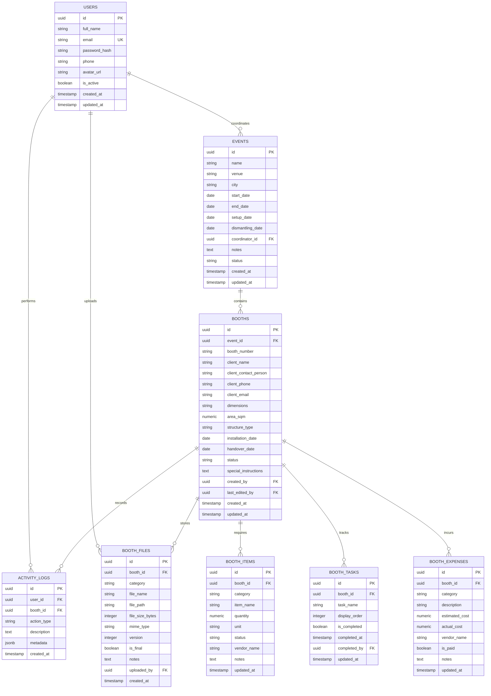

# Reworkzone Stalls — Internal Operations Management System (V1 Architecture & Implementation Specification)

> **Document Type:** System Architecture & Implementation Blueprint for Autonomous AI Builder  
> **Target Scope:** Version 1 (MVP) Internal Operations Workspace  
> **Client / Business:** Reworkzone (`stalls.reworkzone.in`)  
> **Audience:** Development AI / Engineering Team  
> **Status:** Approved for Implementation (No coding in this spec turn; implementation to follow this exact schema)

---

## 1. Executive Summary & Objective

Reworkzone designs, fabricates, and installs bespoke exhibition stalls and pavilions across trade shows in India and internationally. Currently, stall project information—3D renders, working artwork, print-ready files, structural fabrication drawings, furniture orders, electrical requirements, and on-site handovers—is scattered across WhatsApp chats, email threads, and spreadsheets.

### The Objective
Build a lightweight, centralized, internal operations workspace where the Reworkzone event management team can track every exhibition from preparation through installation:
- **Hierarchy:** `Event / Exhibition` &rarr; `Stall / Booth` &rarr; `Detailed Modules` (Design, Print, Production, Furniture, Electrical, Checklist, Expenses, Files).
- **Core Principle:** This is an **operations workspace**, not a complicated enterprise ERP/CRM. No complex role hierarchies, no payment gateways, no accounting engines, and no SMS/Email integrations.
- **Access Model (6-Digit PIN Authentication):**
  - **Phase 1 (Current):** Single shared account protected by a **6-Digit Security PIN** (e.g. `840106`).
  - **Phase 2 (Future-Ready):** Structured for **two accounts / PINs**:
    - **Master / Admin PIN:** Full access to all events, booths, files, checklists, and costing/financials.
    - **Operations / Staff PIN:** Restricted access (can view booths, upload files, update checklist tasks and furniture/electrical items, but cannot view costing/expenses or delete events).

---

## 2. Technical Architecture & Database

### Current Website Architecture & Database Context
The existing portfolio website (`stalls.reworkzone.in`) does **NOT** use PostgreSQL, MySQL, or any external database server:
- Enquiries are saved in a persistent CSV file (`enquiries.csv` in `../reworkzone_leads/`).
- Settings are saved in JSON (`smtp_config.json`).
- Admin access at `/admin` is protected by a simple PIN.

### The Management System Architecture: SQLite
To maintain zero maintenance, zero database hosting fees, and seamless compatibility with Hostinger:
- **Database:** **SQLite 3** (`reworkzone_stalls.sqlite` stored securely outside `public_html` in `../reworkzone_data/`).
  - Native in PHP (`pdo_sqlite`) and Node.js (`better-sqlite3` or `sqlite3`).
  - Single file database with full relational SQL capabilities, transactions, and foreign keys.
  - Zero daemon configuration, zero connection timeouts, instant backups by copying the single `.sqlite` file.
- **Backend Options:**
  - **Option 1 (PHP REST API / Native Hostinger):** Zero extra server or VPS required. Runs directly on the current Hostinger shared hosting using lightweight PHP endpoints (`/api/events.php`, `/api/booths.php`, etc.).
  - **Option 2 (Node.js / Express or NestJS on VPS):** Runs on Node.js using SQLite.
- **Frontend:** React 18 + Vite + Tailwind CSS mounted at `/manage/*`.
- **File Storage:** Private folder on disk (e.g. `../reworkzone_data/booth_files/`) served through authenticated streaming scripts. No public URLs.

```
                         [ Team Member Browser ]
                     (React + Tailwind UI at /manage/*)
                                     │
                             [ 6-Digit PIN Gate ]
                                     │
                            [ Lightweight API ]
                                     │
                    ┌────────────────┴────────────────┐
                    ▼                                 ▼
         [ SQLite Database File ]            [ Private Storage ]
      (../reworkzone_data/stalls.sqlite)     (../reworkzone_data/files/)
```

| Component | Selected Technology | Rationale |
| :--- | :--- | :--- |
| **Frontend** | React 18 + Vite + Tailwind CSS + Lucide Icons | Matches existing site aesthetics; fast, responsive mobile & desktop. |
| **Database** | SQLite 3 (`reworkzone_stalls.sqlite`) | **No PostgreSQL needed.** Single file, ACID compliant, native on Hostinger. |
| **Authentication** | 6-Digit PIN Session | Simple, frictionless team access. Expandable to 2 accounts later. |
| **File Storage** | Private Disk Storage | Stored outside public root, accessed via auth session. |
| **Notifications** | None | No email or SMS overhead. Pure internal dashboard. |

---

## 3. Database Schema (PostgreSQL)

Every entity uses UUIDv4 primary keys and standard audit timestamps (`created_at`, `updated_at`).



### Table Definitions (SQLite Schema)

#### 1. `auth_accounts` (Simple 6-Digit PIN Accounts)
- `id` (INTEGER PRIMARY KEY)
- `account_name` (TEXT NOT NULL) — e.g. "Primary Admin", "Operations Team"
- `pin_hash` (TEXT NOT NULL) — SHA256 / bcrypt hash of the 6-digit PIN
- `role` (TEXT NOT NULL DEFAULT 'master') — `'master'` (full access) or `'operations'` (restricted: cannot view expenses or delete records)
- `is_active` (INTEGER DEFAULT 1)
- `last_login_at` (TEXT)

*Initial Seed:*
- Account 1: Role `'master'`, 6-digit PIN (e.g. `840106`).
- Account 2 (Ready for future activation): Role `'operations'`, 6-digit PIN (e.g. `898000`).

#### 2. `events`
- `id` (TEXT PRIMARY KEY) — UUIDv4 or nanoId
- `name` (TEXT NOT NULL) — e.g. "Tech Expo 2026"
- `venue` (TEXT NOT NULL) — e.g. "Exhibition Centre, Ahmedabad"
- `city` (TEXT NOT NULL)
- `start_date` (TEXT NOT NULL) — ISO format YYYY-MM-DD
- `end_date` (TEXT NOT NULL)
- `setup_date` (TEXT NOT NULL)
- `dismantling_date` (TEXT NOT NULL)
- `coordinator_name` (TEXT) — e.g. "Chintan", "Rahul"
- `notes` (TEXT)
- `status` (TEXT DEFAULT 'upcoming') — `upcoming`, `in_progress`, `completed`, `archived`
- `created_at` (TEXT DEFAULT CURRENT_TIMESTAMP)
- `updated_at` (TEXT DEFAULT CURRENT_TIMESTAMP)

#### 3. `booths`
- `id` (UUID, PK)
- `event_id` (UUID, FK &rarr; `events.id`, ON DELETE CASCADE, NOT NULL)
- `booth_number` (VARCHAR(50), NOT NULL) — e.g. "A01", "Hall 3 - E26"
- `client_name` (VARCHAR(200), NOT NULL) — e.g. "MagnusMinds"
- `client_contact_person` (VARCHAR(150))
- `client_phone` (VARCHAR(30))
- `client_email` (VARCHAR(255))
- `dimensions` (VARCHAR(100)) — e.g. "20 × 10 ft (6m × 3m)"
- `area_sqm` (DECIMAL(8,2))
- `structure_type` (VARCHAR(100)) — e.g. "3 sides open", "Corner", "Island Stand", "Double Decker"
- `installation_date` (DATE)
- `handover_date` (DATE)
- `status` (VARCHAR(50), Default: `'not_started'`)
  - Permitted Statuses: `not_started`, `design_pending`, `in_production`, `installed`, `closed`
- `special_instructions` (TEXT)
- `created_by` (UUID, FK &rarr; `users.id`)
- `last_edited_by` (UUID, FK &rarr; `users.id`)
- `created_at` / `updated_at` (TIMESTAMPTZ)

#### 4. `booth_files`
- `id` (UUID, PK)
- `booth_id` (UUID, FK &rarr; `booths.id`, ON DELETE CASCADE, NOT NULL)
- `category` (VARCHAR(50), NOT NULL)
  - Categories: `client_assets`, `3d_design`, `artwork`, `print_ready`, `production`, `references`, `installation`
- `file_name` (VARCHAR(255), NOT NULL) — Original filename
- `file_path` (TEXT, NOT NULL) — Internal storage path (e.g. `storage/events/{event_id}/{booth_id}/{category}/{uuid}.pdf`)
- `file_size_bytes` (BIGINT, NOT NULL)
- `mime_type` (VARCHAR(100), NOT NULL)
- `version` (INT, Default: 1)
- `is_final` (BOOLEAN, Default: `false`) — **Crucial:** separates draft artwork from final approved printer files
- `notes` (TEXT)
- `uploaded_by` (UUID, FK &rarr; `users.id`)
- `created_at` (TIMESTAMPTZ)

#### 5. `booth_items`
- `id` (UUID, PK)
- `booth_id` (UUID, FK &rarr; `booths.id`, ON DELETE CASCADE, NOT NULL)
- `category` (VARCHAR(50), NOT NULL)
  - Categories: `furniture`, `electrical`, `printing`, `structure`, `production`, `misc`
- `item_name` (VARCHAR(200), NOT NULL) — e.g. "High Bar Stools", "Spotlights 50W", "Reception Counter", "Vinyl Banner 3x8ft"
- `quantity` (DECIMAL(8,2), NOT NULL, Default: 1)
- `unit` (VARCHAR(30), Default: `'pcs'`) — `pcs`, `sq ft`, `meters`, `sets`
- `status` (VARCHAR(30), Default: `'pending'`) — `pending`, `ordered`, `ready`, `dispatched`, `installed`
- `vendor_name` (VARCHAR(150), NULLABLE)
- `notes` (TEXT)
- `created_at` / `updated_at` (TIMESTAMPTZ)

#### 6. `booth_tasks` (Checklist)
- `id` (UUID, PK)
- `booth_id` (UUID, FK &rarr; `booths.id`, ON DELETE CASCADE, NOT NULL)
- `task_name` (VARCHAR(255), NOT NULL)
- `display_order` (INT, Default: 0)
- `is_completed` (BOOLEAN, Default: `false`)
- `completed_at` (TIMESTAMPTZ, NULLABLE)
- `completed_by` (UUID, FK &rarr; `users.id`, NULLABLE)
- `updated_at` (TIMESTAMPTZ)

*Standard 10-Step Default Seed for Every New Booth:*
1. Client details confirmed
2. Design approved
3. Print files finalized
4. Printing completed
5. Structure fabricated
6. Furniture arranged
7. Electrical items ready
8. Material dispatched
9. Stall installation completed
10. Final handover completed

#### 7. `booth_expenses` (Costing)
- `id` (UUID, PK)
- `booth_id` (UUID, FK &rarr; `booths.id`, ON DELETE CASCADE, NOT NULL)
- `category` (VARCHAR(50), NOT NULL) — `printing`, `structure`, `furniture`, `electrical`, `transport`, `labor`, `other`
- `description` (VARCHAR(255), NOT NULL)
- `estimated_cost` (DECIMAL(12,2), Default: 0.00)
- `actual_cost` (DECIMAL(12,2), Default: 0.00)
- `vendor_name` (VARCHAR(150))
- `is_paid` (BOOLEAN, Default: `false`)
- `notes` (TEXT)
- `created_at` / `updated_at` (TIMESTAMPTZ)

#### 8. `activity_logs`
- `id` (UUID, PK)
- `user_id` (UUID, FK &rarr; `users.id`, NULLABLE)
- `booth_id` (UUID, FK &rarr; `booths.id`, ON DELETE CASCADE, NULLABLE)
- `action_type` (VARCHAR(50)) — e.g. `booth_created`, `file_uploaded`, `status_changed`, `item_updated`
- `description` (TEXT) — Human-readable text (e.g. "Rahul Sharma marked Print files finalized as completed")
- `metadata` (JSONB)
- `created_at` (TIMESTAMPTZ, Default: `NOW()`)

---

## 4. RESTful API Endpoint Specifications

Base Path: `/api/v1`  
Authentication: Bearer JWT in `Authorization` header or secure HttpOnly cookie.

### Authentication & Team
- `POST /api/v1/auth/login` — `{ email, password }` &rarr; `{ token, user }`
- `GET /api/v1/auth/me` — Return current logged-in user profile
- `POST /api/v1/auth/logout` — Invalidate session
- `GET /api/v1/team` — List all team members
- `POST /api/v1/team` — Invite / add a team member

### Events
- `GET /api/v1/events` — Query: `?status=upcoming|in_progress&search=tech`
- `POST /api/v1/events` — Create exhibition record
- `GET /api/v1/events/:id` — Event details + summary stats (total stalls, progress %)
- `PUT /api/v1/events/:id` — Update event dates, venue, notes
- `DELETE /api/v1/events/:id` — Archive / soft-delete event

### Booths (The Core Entity)
- `GET /api/v1/booths` — Query: `?eventId=uuid&status=in_production&search=query`
- `POST /api/v1/booths` — Create stall under an event (auto-seeds 10 default checklist tasks)
- `GET /api/v1/booths/:id` — Full booth bundle: client details, tabs data, checklist %
- `PUT /api/v1/booths/:id` — Update booth information or main status
- `POST /api/v1/booths/:id/duplicate` — Duplicate booth structure/item lists for a sister stall

### Booth Files (Private File Storage)
- `GET /api/v1/booths/:id/files` — List files grouped by category (`client_assets`, `3d_design`, `artwork`, `print_ready`, etc.)
- `POST /api/v1/booths/:id/files` — Multipart form upload (`file`, `category`, `version`, `is_final`, `notes`)
- `GET /api/v1/files/:fileId/download` — Stream file with proper MIME type & content disposition (authentication required)
- `PATCH /api/v1/files/:fileId/set-final` — Toggle `is_final` flag (automatically unmarks previous final files in the same category)
- `DELETE /api/v1/files/:fileId` — Remove file

### Items (Furniture, Electrical, Print, Production)
- `GET /api/v1/booths/:id/items` — Query: `?category=furniture|electrical|printing`
- `POST /api/v1/booths/:id/items` — Add item (`category`, `item_name`, `quantity`, `unit`, `status`, `vendor_name`)
- `PATCH /api/v1/items/:itemId` — Inline update status (`pending`, `ready`, etc.) or quantity
- `DELETE /api/v1/items/:itemId` — Remove item

### Checklist & Tasks
- `GET /api/v1/booths/:id/tasks` — List checklist tasks ordered by `display_order`
- `PATCH /api/v1/tasks/:taskId/toggle` — Toggle completion (updates `is_completed`, `completed_at`, `completed_by`)
- `POST /api/v1/booths/:id/tasks` — Add custom task to booth
- `PUT /api/v1/booths/:id/tasks/reorder` — Update task sequence

### Costing & Expenses
- `GET /api/v1/booths/:id/expenses` — Returns list + computed totals:
  $$\text{Total Estimated}, \quad \text{Total Actual}, \quad \text{Difference} = \text{Actual} - \text{Estimated}$$
- `POST /api/v1/booths/:id/expenses` — Add expense line item
- `PATCH /api/v1/expenses/:expenseId` — Update expense item
- `DELETE /api/v1/expenses/:expenseId` — Delete expense

### Activity & Dashboard Summary
- `GET /api/v1/dashboard/stats` — Quick counts: Active Events, Total Booths, In Production, Pending Tasks
- `GET /api/v1/activity-logs` — Recent operations audit feed

---

## 5. Frontend UI & Routing Specifications

Route Prefix: `/manage/*`  
Theme: Clean, high-contrast, professional admin aesthetic matching Reworkzone brand (#111827 dark, #E53935 accent red, #FAF9F5 background).

```
/manage/login                 --> Clean team authentication screen
/manage                       --> Operations Dashboard (KPI counters, active stalls, urgent tasks)
/manage/events                --> Events Directory (cards with dates, booth counts, status badges)
/manage/events/:id            --> Single Event Hub (overview + list of stalls in this event)
/manage/booths                --> Master Stalls Directory (searchable, filterable by event & status)
/manage/booths/:id            --> Stall Detail Command Center (8 interactive tabs)
  ├── Tab 1: Overview         (Client info, stall size, dates, completion progress circle)
  ├── Tab 2: Design           (3D renders, reference images, revision logs)
  ├── Tab 3: Print            (Working AI/CDR/PSD vs Approved Print-Ready PDFs)
  ├── Tab 4: Production       (Fabrication specs, dimensions, structural drawings)
  ├── Tab 5: Furniture        (Editable table: item, pcs, status, vendor)
  ├── Tab 6: Electrical       (Lights, power sockets, load specs, status)
  ├── Tab 7: Files            (Complete file library with drag-and-drop upload)
  └── Tab 8: Checklist & Cost (10-step progress checklist + Estimated vs Actual expenses)
/manage/settings              --> Team member accounts & profile
```

### UI Components & Wireframe Guidelines
1. **Completion Bar & Circular Metric:**
   - Automatically derived from checklist:
     $$\text{Progress \%} = \left(\frac{\text{Completed Tasks}}{\text{Total Tasks}}\right) \times 100$$
2. **File Versioning & Safety Badges:**
   - Any file with `is_final: true` is highlighted with an emerald badge: **"APPROVED FOR PRINT"**.
   - Working artwork files display an amber badge: **"WORKING DRAFT"**.
   - Prevents accidental dispatch of old or unfinished artwork to print vendors.
3. **Editable Items Table:**
   - Single-click status pill change (e.g. clicking `Pending` turns it to `Ready` with immediate visual feedback).
4. **Mobile Responsive:**
   - On-site team members at the exhibition venue can check off tasks and upload installation photos directly from mobile browsers.

---

## 6. Security & File Storage Architecture

1. **Private File System:**
   - Files are stored in a non-public folder (e.g. `/var/reworkzone_storage/` on the VPS).
   - Direct web access to file paths is blocked by Nginx.
   - File downloads must pass through NestJS authentication middleware (`GET /api/v1/files/:id/download`).
2. **Access Security:**
   - Individual credentials for every team member.
   - All mutations log the user's `id` and `timestamp` in `activity_logs`.
   - Rate limiting on `/api/v1/auth/login` to prevent brute force.
3. **Database Integrity:**
   - Automated nightly PostgreSQL `pg_dump` backups stored in a secondary backup directory or S3 bucket.

---

## 7. Version 1 (MVP) vs Version 2 Boundaries

| Feature | Version 1 (Build First) | Version 2 (Future / Out of Scope) |
| :--- | :---: | :---: |
| Team Authentication (Individual Logins) | ✅ Yes | — |
| Single Shared Permission Level | ✅ Yes | — |
| Event Creation & Scheduling | ✅ Yes | — |
| Booth Creation with 8 Tab Views | ✅ Yes | — |
| Categorized File Uploads & Versions | ✅ Yes | — |
| Approved "Final" File Flagging | ✅ Yes | — |
| Furniture & Material Items Checklist | ✅ Yes | — |
| 10-Step Default Checklist with Auto % | ✅ Yes | — |
| Basic Costing (Estimated vs Actual) | ✅ Yes | — |
| Search & Multi-Filter by Event/Status | ✅ Yes | — |
| Responsive Mobile & Desktop Layout | ✅ Yes | — |
| Excel / CSV Export of Stall Summaries | ❌ Post-MVP | ✅ V2 |
| PDF Stall Handover Sheet Generation | ❌ Post-MVP | ✅ V2 |
| Reusable Stall Blueprint Templates | ❌ Post-MVP | ✅ V2 |
| Centralized Inventory Stock Accounting | ❌ Out of Scope | Not needed |
| Multi-role RBAC (Designer vs Vendor) | ❌ Out of Scope | Not needed |
| Automated WhatsApp / SMS Notifications | ❌ Out of Scope | Evaluated in V2 |

---

## 8. Implementation Steps for the Builder AI

When the user or building agent begins coding this system, execute in the following sequential order:

1. **Step 1: Database Migration**
   - Initialize PostgreSQL database `reworkzone_stalls`.
   - Run the DDL scripts to create all 8 tables (`users`, `events`, `booths`, `booth_files`, `booth_items`, `booth_tasks`, `booth_expenses`, `activity_logs`).
   - Create initial admin/team seed accounts with hashed passwords.

2. **Step 2: NestJS Backend Service**
   - Setup NestJS project with TypeORM or Prisma ORM.
   - Implement Auth module (JWT + bcrypt).
   - Implement Events, Booths, Items, Tasks, and Expenses CRUD modules.
   - Implement File Storage service with streaming endpoint and `is_final` version logic.

3. **Step 3: Frontend Client Integration**
   - Mount `/manage` route in React router.
   - Build Dashboard view with KPI metric tiles and recent booths table.
   - Build Booth Detail page with the 8 tabbed controllers.
   - Build file upload modal with category selector and version tracker.
   - Build checklist and inline item status toggle.

4. **Step 4: Nginx & Production Deployment**
   - Configure Nginx reverse proxy to route `/manage` and `/api/v1` to the respective Vite build and NestJS port.
   - Secure private file storage directory permissions.
   - Verify mobile responsiveness and on-site photo upload workflow.
