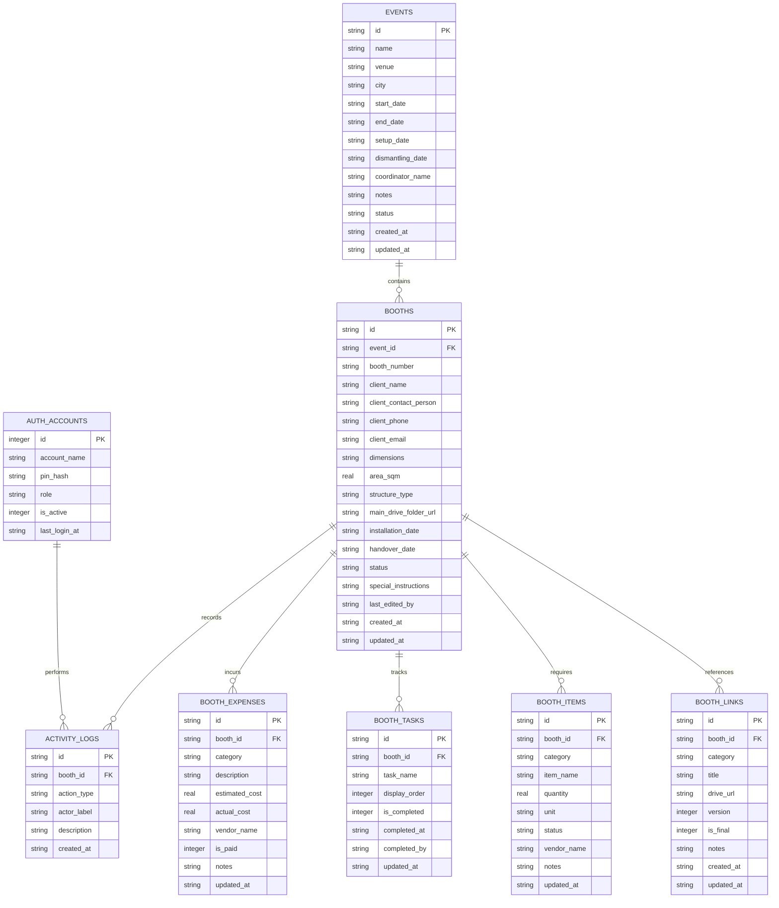

# Reworkzone Stalls — Internal Operations Management System (V1 Architecture & Implementation Specification)

> **Document Type:** System Architecture & Implementation Blueprint for Autonomous AI Builder  
> **Target Scope:** Version 1 (MVP) Internal Operations Workspace  
> **Client / Business:** Reworkzone (`stalls.reworkzone.in`)  
> **Audience:** Development AI / Engineering Team  
> **Status:** Approved for Implementation (6-Digit PIN Auth + SQLite Database + Google Drive Links)

---

## 1. Executive Summary & Objective

Reworkzone designs, fabricates, and installs bespoke exhibition stalls and pavilions across trade shows in India and internationally. Currently, stall project information—3D renders, working artwork, print-ready files, structural fabrication drawings, furniture orders, electrical requirements, and on-site handovers—is scattered across WhatsApp chats, email threads, and spreadsheets.

### The Objective
Build a lightweight, centralized, internal operations workspace where the Reworkzone event management team can track every exhibition from preparation through installation:
- **Hierarchy:** `Event / Exhibition` &rarr; `Stall / Booth` &rarr; `Detailed Modules` (Design, Print, Production, Furniture, Electrical, Checklist, Expenses, Drive Links).
- **Core Principle:** This is an **operations workspace**, not a complicated enterprise ERP/CRM. No complex role hierarchies, no payment gateways, no accounting engines, and no SMS/Email integrations.
- **File Management Principle (Google Drive Links Only):**
  - **No binary file uploads to the server:** Large design files (`.ai`, `.psd`, `.cdr`), 3D renders, and high-res print PDFs are hosted on Google Drive where the team already works.
  - The system saves and organizes **Google Drive URLs and metadata** (Main Folder + categorized links with `is_final` approval flags). Google Drive manages file permissions, storage capacity, and bandwidth.
- **Access Model (6-Digit PIN Authentication):**
  - **Phase 1 (Current):** Single shared account protected by a **6-Digit Security PIN** (e.g. `840106`).
  - **Phase 2 (Future-Ready):** Structured for **two accounts / PINs**:
    - **Master / Admin PIN:** Full access to all events, booths, drive links, checklists, and costing/financials.
    - **Operations / Staff PIN:** Restricted access (can view booths, add/view drive links, update checklist tasks and furniture/electrical items, but cannot view costing/expenses or delete events).

---

## 2. Technical Architecture & Database

### Current Website Architecture & Database Context
The existing portfolio website (`stalls.reworkzone.in`) does **NOT** use PostgreSQL, MySQL, or any external database server:
- Enquiries are saved in a persistent CSV file (`enquiries.csv` in `../reworkzone_leads/`).
- Settings are saved in JSON (`smtp_config.json`).
- Admin access at `/admin` is protected by a simple PIN.

### The Management System Architecture: SQLite + Google Drive Links
To maintain zero maintenance, zero database hosting fees, and seamless compatibility with Hostinger:
- **Database:** **SQLite 3** (`reworkzone_stalls.sqlite` stored securely outside `public_html` in `../reworkzone_data/`).
  - Native in PHP (`pdo_sqlite`) and Node.js (`better-sqlite3` or `sqlite3`).
  - Single file database with full relational SQL capabilities, transactions, and foreign keys.
  - Zero daemon configuration, zero connection timeouts, instant backups by copying the single `.sqlite` file.
- **Backend:** Lightweight PHP REST API running directly on the existing Hostinger hosting (or lightweight Node.js service).
- **Frontend:** React 18 + Vite + Tailwind CSS mounted at `/manage/*`.
- **File Storage:** **Zero local server disk usage.** Replaced entirely with **Google Drive Link Management**. Each stall links to its primary Google Drive folder plus individual categorized links (Working Artwork, 3D Renders, Print-Ready PDFs, Photos).

```
                         [ Team Member Browser ]
                     (React + Tailwind UI at /manage/*)
                                     │
                             [ 6-Digit PIN Gate ]
                        (bcrypt/Argon2id + Lockout)
                                     │
                            [ Lightweight API ]
                                     │
                    ┌────────────────┴────────────────┐
                    ▼                                 ▼
         [ SQLite Database File ]            [ Google Drive Links ]
      (../reworkzone_data/stalls.sqlite)     (Main Folder & File URLs)
```

| Component | Selected Technology | Rationale |
| :--- | :--- | :--- |
| **Frontend** | React 18 + Vite + Tailwind CSS + Lucide Icons | Matches existing site aesthetics; fast, responsive mobile & desktop. |
| **Database** | SQLite 3 (`reworkzone_stalls.sqlite`) | **No PostgreSQL needed.** Single file, ACID compliant, native on Hostinger. |
| **Authentication** | 6-Digit PIN Session | Secure `password_hash()` (bcrypt/Argon2id) with attempt limits. |
| **File Management** | **Google Drive Links Only** | **No server uploads.** Saves Drive URLs; team uses existing Google Drive storage. |
| **Notifications** | None | No email or SMS overhead. Pure internal dashboard. |

---

## 3. Database Schema (SQLite 3)

All entities use standard ISO-8601 string timestamps and text UUIDs.



### Table Definitions (SQLite Schema)

#### 1. `auth_accounts` (Simple 6-Digit PIN Accounts)
- `id` (INTEGER PRIMARY KEY)
- `account_name` (TEXT NOT NULL) — e.g. "Primary Admin", "Operations Team"
- `pin_hash` (TEXT NOT NULL) — Hash created using PHP `password_hash()` with `PASSWORD_BCRYPT` or `PASSWORD_ARGON2ID`
- `role` (TEXT NOT NULL DEFAULT 'master') — `'master'` (full access) or `'operations'` (restricted: cannot view expenses or delete records)
- `is_active` (INTEGER DEFAULT 1)
- `last_login_at` (TEXT)

*Initial Seed:*
- Account 1: Role `'master'`, 6-digit PIN (e.g. `840106`).
- Account 2 (Ready for future activation): Role `'operations'`, 6-digit PIN (e.g. `898000`).

#### 2. `events`
- `id` (TEXT PRIMARY KEY) — UUIDv4 or nanoId
- `name` (TEXT NOT NULL) — e.g. "Tech Expo 2026"
- `venue` (TEXT NOT NULL) — e.g. "Exhibition Centre, Ahmedabad"
- `city` (TEXT NOT NULL)
- `start_date` (TEXT NOT NULL) — ISO format YYYY-MM-DD
- `end_date` (TEXT NOT NULL)
- `setup_date` (TEXT NOT NULL)
- `dismantling_date` (TEXT NOT NULL)
- `coordinator_name` (TEXT) — e.g. "Chintan", "Rahul"
- `notes` (TEXT)
- `status` (TEXT DEFAULT 'upcoming') — `upcoming`, `in_progress`, `completed`, `archived`
- `created_at` (TEXT DEFAULT CURRENT_TIMESTAMP)
- `updated_at` (TEXT DEFAULT CURRENT_TIMESTAMP)

#### 3. `booths`
- `id` (TEXT PRIMARY KEY)
- `event_id` (TEXT NOT NULL, REFERENCES `events(id)` ON DELETE CASCADE)
- `booth_number` (TEXT NOT NULL) — e.g. "A01", "Hall 3 - E26"
- `client_name` (TEXT NOT NULL) — e.g. "MagnusMinds"
- `client_contact_person` (TEXT)
- `client_phone` (TEXT)
- `client_email` (TEXT)
- `dimensions` (TEXT) — e.g. "20 × 10 ft (6m × 3m)"
- `area_sqm` (REAL)
- `structure_type` (TEXT) — e.g. "3 sides open", "Corner", "Island Stand"
- `main_drive_folder_url` (TEXT) — **Google Drive Master Folder Link for this Stall**
- `installation_date` (TEXT)
- `handover_date` (TEXT)
- `status` (TEXT DEFAULT 'not_started') — `not_started`, `design_pending`, `in_production`, `installed`, `closed`
- `special_instructions` (TEXT)
- `last_edited_by` (TEXT)
- `created_at` (TEXT DEFAULT CURRENT_TIMESTAMP)
- `updated_at` (TEXT DEFAULT CURRENT_TIMESTAMP)

#### 4. `booth_links` (Replaces File Uploads with Google Drive Links)
- `id` (TEXT PRIMARY KEY)
- `booth_id` (TEXT NOT NULL, REFERENCES `booths(id)` ON DELETE CASCADE)
- `category` (TEXT NOT NULL) — `client_assets`, `3d_design`, `artwork`, `print_ready`, `production`, `references`, `installation`
- `title` (TEXT NOT NULL) — e.g. "Front Fascia Approved Print PDF", "3D Stall Render V2", "Electrical Layout DWG"
- `drive_url` (TEXT NOT NULL) — Full Google Drive URL
- `version` (INTEGER DEFAULT 1) — Optional revision number
- `is_final` (INTEGER DEFAULT 0) — **1 = Final Approved Link, 0 = Working Draft**
- `notes` (TEXT) — e.g. "Approved by client on WhatsApp 9 Dec; CMYK 300 DPI"
- `created_at` (TEXT DEFAULT CURRENT_TIMESTAMP)
- `updated_at` (TEXT DEFAULT CURRENT_TIMESTAMP)

#### 5. `booth_items`
- `id` (TEXT PRIMARY KEY)
- `booth_id` (TEXT NOT NULL, REFERENCES `booths(id)` ON DELETE CASCADE)
- `category` (TEXT NOT NULL) — `furniture`, `electrical`, `printing`, `structure`, `production`, `misc`
- `item_name` (TEXT NOT NULL) — e.g. "High Bar Stools", "Spotlights 50W", "Reception Counter"
- `quantity` (REAL NOT NULL DEFAULT 1)
- `unit` (TEXT DEFAULT 'pcs') — `pcs`, `sq ft`, `meters`, `sets`
- `status` (TEXT DEFAULT 'pending') — `pending`, `ordered`, `ready`, `dispatched`, `installed`
- `vendor_name` (TEXT)
- `notes` (TEXT)
- `updated_at` (TEXT DEFAULT CURRENT_TIMESTAMP)

#### 6. `booth_tasks` (Checklist)
- `id` (TEXT PRIMARY KEY)
- `booth_id` (TEXT NOT NULL, REFERENCES `booths(id)` ON DELETE CASCADE)
- `task_name` (TEXT NOT NULL)
- `display_order` (INTEGER DEFAULT 0)
- `is_completed` (INTEGER DEFAULT 0)
- `completed_at` (TEXT)
- `completed_by` (TEXT)
- `updated_at` (TEXT DEFAULT CURRENT_TIMESTAMP)

*Standard 10 Default Tasks:*
1. Client details confirmed
2. Design approved
3. Print files finalized
4. Printing completed
5. Structure fabricated
6. Furniture arranged
7. Electrical items ready
8. Material dispatched
9. Stall installation completed
10. Final handover completed

#### 7. `booth_expenses` (Costing)
- `id` (TEXT PRIMARY KEY)
- `booth_id` (TEXT NOT NULL, REFERENCES `booths(id)` ON DELETE CASCADE)
- `category` (TEXT NOT NULL) — `printing`, `structure`, `furniture`, `electrical`, `transport`, `labor`, `other`
- `description` (TEXT NOT NULL)
- `estimated_cost` (REAL DEFAULT 0.0)
- `actual_cost` (REAL DEFAULT 0.0)
- `vendor_name` (TEXT)
- `is_paid` (INTEGER DEFAULT 0)
- `notes` (TEXT)
- `updated_at` (TEXT DEFAULT CURRENT_TIMESTAMP)

#### 8. `activity_logs`
- `id` (TEXT PRIMARY KEY)
- `booth_id` (TEXT)
- `action_type` (TEXT)
- `actor_label` (TEXT) — e.g. "Master Admin" or "Operations"
- `description` (TEXT)
- `created_at` (TEXT DEFAULT CURRENT_TIMESTAMP)

---

## 4. Simple 6-Digit PIN Authentication Flow

```
[ User visits /manage ]
         │
         ▼
[ Is session active? ] ──► YES ──► [ Open Operations Dashboard ]
         │
        NO
         ▼
[ Show 6-Digit PIN Pad ]
  ┌───┬───┬───┐
  │ 1 │ 2 │ 3 │
  ├───┼───┼───┤
  │ 4 │ 5 │ 6 │
  ├───┼───┼───┤
  │ 7 │ 8 │ 9 │
  └───┴───┴───┘
         │
   [ Submits PIN ]
         │
         ▼
[ Verify via password_verify() ]
  ├── PIN 1 (Master)     ──► Role: 'master'     (Full Read/Write/Costing)
  └── PIN 2 (Operations) ──► Role: 'operations' (Checklists, items, links; costing hidden)
```

- Clean numeric keypad on mobile or standard keyboard on desktop.
- 6-digit auto-submit on 6th digit.
- **Brute-Force Lockout**: 5 consecutive failed attempts lock submissions for 15 minutes.
- Encrypted HTTP-only session cookie (`SameSite=Lax`, `Secure`).

---

## 5. Frontend UI & Routing Specifications

Route Prefix: `/manage/*`  
Theme: Clean, high-contrast, professional admin aesthetic matching Reworkzone brand (#111827 dark, #E53935 accent red, #FAF9F5 background).

```
/manage/login                 --> 6-Digit PIN Pad entry screen
/manage                       --> Operations Dashboard (KPI counters, active stalls, urgent tasks)
/manage/events                --> Events Directory (cards with dates, booth counts, status badges)
/manage/events/:id            --> Single Event Hub (overview + list of stalls in this event)
/manage/booths                --> Master Stalls Directory (searchable, filterable by event & status)
/manage/booths/:id            --> Stall Detail Command Center (8 interactive tabs)
  ├── Tab 1: Overview         (Client info, stall size, dates, Main Drive Folder button, progress circle)
  ├── Tab 2: Design           (3D renders Google Drive links, revision history)
  ├── Tab 3: Print            (Working AI/CDR/PSD links vs Approved Print-Ready PDF links)
  ├── Tab 4: Production       (Fabrication specs, dimensions, structural drawings Drive links)
  ├── Tab 5: Furniture        (Editable table: item, pcs, status, vendor)
  ├── Tab 6: Electrical       (Lights, power sockets, load specs, status)
  ├── Tab 7: Drive Links      (Complete Google Drive Link Library: Add Link, category filter, 1-click open)
  └── Tab 8: Checklist & Cost (10-step progress checklist + Estimated vs Actual expenses; role-protected)
/manage/settings              --> PIN management & Manual SQLite Database Backup Download
```

### Google Drive Links UI Component
- **Main Drive Folder Card:** Displayed prominently at top of booth page:  
  `[ 📁 Open Google Drive Master Folder ↗ ]`
- **Link Entry Form Modal:**
  - *Category:* Select from `Print Ready`, `3D Design`, `Working Artwork`, `Production`, `References`, `Installation`.
  - *Title:* e.g. "Approved Backwall Banner 6x3m (Print PDF)".
  - *Google Drive URL:* `https://drive.google.com/...`
  - *Version / Revision:* e.g. `v2`.
  - *Is Final:* Checkbox `[x] Mark as Final Approved Print File`.
  - *Notes:* Optional notes for printer or fabricator.
- **Visual Safety Badges:**
  - `is_final = 1`: Highlighted with an emerald badge **"APPROVED FOR PRINT"**.
  - `is_final = 0`: Highlighted with an amber badge **"WORKING DRAFT"**.

---

## 6. Security, Reliability & Hosting Architecture

### Hosting Environment & Deployment Safeguards
1. **Hosting Environment**: Hostinger Shared / Cloud Hosting running Apache 2.4 + PHP 8.x.
2. **Web Routing**: `.htaccess` handles SPA routing (`RewriteRule . /index.html [L]`) and routes `/admin` to `admin.php`.
3. **Git Deployment Behavior**: Hostinger Git integration runs `git reset --hard origin/main` on push. Any untracked files inside `public_html` are wiped on deploy.
4. **Persistent Storage Location**: The SQLite database MUST reside outside the deploy root in `../reworkzone_data/reworkzone_stalls.sqlite` with directory permissions `0755`.
5. **No Server Disk Overhead**: Because design and print files are stored as Google Drive links, server disk space is never consumed by large binaries.

### Security Hardening Guidelines
1. **PIN Security**:
   - Stored using PHP `password_hash()` with `PASSWORD_BCRYPT` (cost 12) or `PASSWORD_ARGON2ID`.
   - Rate limiting: 5 failed attempts $\rightarrow$ 15-minute lockout.
2. **Database Protection**:
   - Database file placed in `../reworkzone_data/`.
   - `.htaccess` rule added to deny direct HTTP requests to any database or backup file:
     ```apache
     <FilesMatch "\.(sqlite|db|csv|log|bak|env)$">
       Require all denied
     </FilesMatch>
     ```
3. **Consistent Backups & Offsite Redundancy**:
   - Automated daily SQLite snapshot stored in `../reworkzone_data/backups/`.
   - **Manual Offsite Backup Download:** A dedicated **"Download Database Backup"** button in `/manage/settings` allows the administrator to download a `.sqlite` snapshot to their local computer with a single click.

---

## 7. Version 1 (MVP) vs Version 2 Boundaries

| Feature | Version 1 (Build First) | Version 2 (Future / Out of Scope) |
| :--- | :---: | :---: |
| 6-Digit PIN Authentication (1 Account) | ✅ Yes | — |
| Multi-Account Access (2 Accounts: Master vs Ops) | Ready in DB | ✅ Role distinction activated |
| Event Creation & Scheduling | ✅ Yes | — |
| Booth Creation with 8 Tab Views | ✅ Yes | — |
| Main Google Drive Folder per Booth | ✅ Yes | — |
| Categorized Google Drive File Links | ✅ Yes | — |
| Approved "Final" File Flagging | ✅ Yes | — |
| Furniture & Material Items Checklist | ✅ Yes | — |
| 10-Step Default Checklist with Auto % | ✅ Yes | — |
| Basic Costing (Estimated vs Actual) | ✅ Yes | — |
| Search & Multi-Filter by Event/Status | ✅ Yes | — |
| Responsive Mobile & Desktop Layout | ✅ Yes | — |
| Automated SQLite Daily Backups | ✅ Yes | — |
| 1-Click SQLite Backup Download | ✅ Yes | — |
| Direct Server File Uploads | ❌ Removed | Replaced by Google Drive Links |
| Excel / CSV Export of Stall Summaries | ❌ Post-MVP | ✅ V2 |
| PDF Stall Handover Sheet Generation | ❌ Post-MVP | ✅ V2 |
| Reusable Stall Blueprint Templates | ❌ Post-MVP | ✅ V2 |
| Automated WhatsApp / SMS Notifications | ❌ Out of Scope | Not needed |

---

## 8. Recommended Implementation Order for Builder AI

The autonomous builder AI should execute the build following these **7 sequential steps**:

### Step 1: Inspect existing website, hosting setup, PHP version & admin auth
- Inspect the existing website structure, Hostinger Apache `.htaccess` rules, and PHP runtime.
- Verify that persistent storage path `../reworkzone_data/` is writable.
- Confirm zero modifications to the public portfolio landing page and `/send-enquiry.php`.

### Step 2: Create the SQLite database and secure PIN authentication
- Create SQLite database `reworkzone_stalls.sqlite` with the 8 relational tables (including `booth_links` and `main_drive_folder_url`).
- Seed the initial Master 6-Digit PIN account using `password_hash()` with `PASSWORD_BCRYPT`.
- Build the PIN verification API endpoint with 5-attempt rate-limiting lockout and secure session cookies.

### Step 3: Build dashboard, event management, and booth management pages
- Build the `/manage` PIN gate UI (clean numeric keypad + keyboard support).
- Build the Dashboard overview with KPI tiles (Active Events, Total Booths, In Production, Pending Tasks).
- Build the Event management interface (create, list, edit event dates and venues).
- Build the Booth listing with event filtering, status badges, and search.

### Step 4: Add Google Drive links management, production, furniture, and electrical management
- Implement the Booth Details screen with the 8 interactive tabs.
- Build the **Main Google Drive Folder** input and 1-click redirect button.
- Build the **Google Drive Links Library** (`booth_links`) with category filtering (`Print Ready`, `3D Design`, `Working Artwork`, `Production`, `References`, `Installation`).
- Add the **"Mark as Final Approved Print File"** toggle with visual safety badges.
- Build editable item tables for Furniture, Electrical, and Fabrication materials.

### Step 5: Implement checklists, costing, search, and activity logging
- Implement the 10-step progress checklist with auto-calculated percentage completion.
- Build the Costing module (Estimated vs. Actual table with auto-calculated difference).
- Implement activity logging (`activity_logs`) to track updates and changes.

### Step 6: Test permissions, drive links, mobile layout, backups, and complete workflow
- Test that unauthenticated users cannot access any `/manage` views or `/api/manage/*` endpoints.
- Verify that opening Google Drive links opens correctly in new tabs.
- Verify mobile responsiveness on venue/mobile screens for on-site checklist updates.
- Test SQLite daily backup creation and the 1-click **Download DB Backup** feature.

### Step 7: Deploy under `/manage` without disturbing the public website or enquiry system
- Mount `/manage` in the React frontend (or dedicated SPA bundle).
- Add `.htaccess` routing rules for `/manage` without affecting `/` or `/admin`.
- Run final production build and sync to repository root for seamless Hostinger Git deployment.
